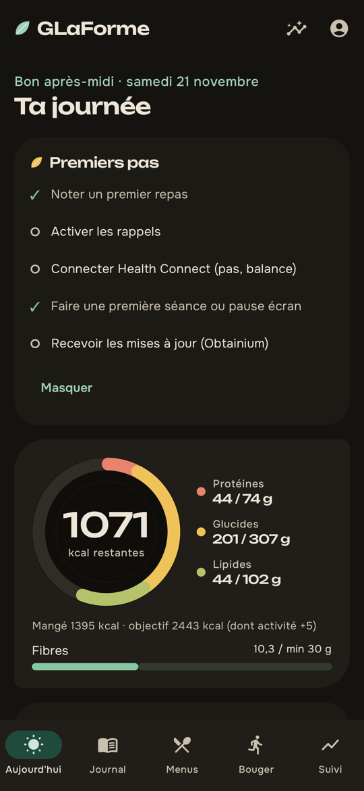
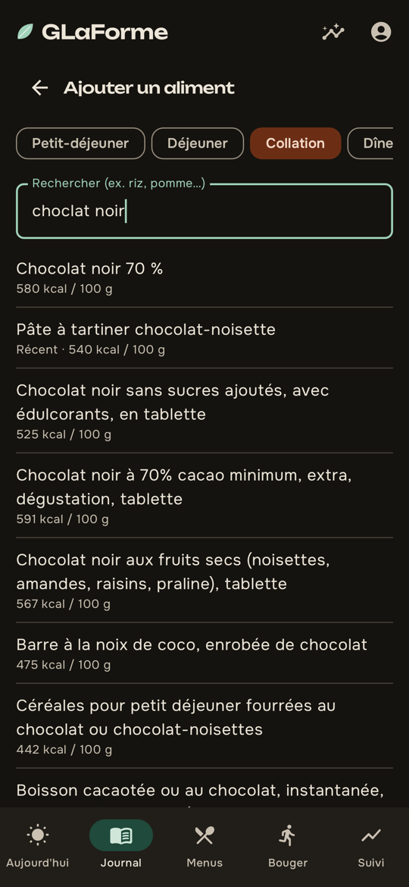
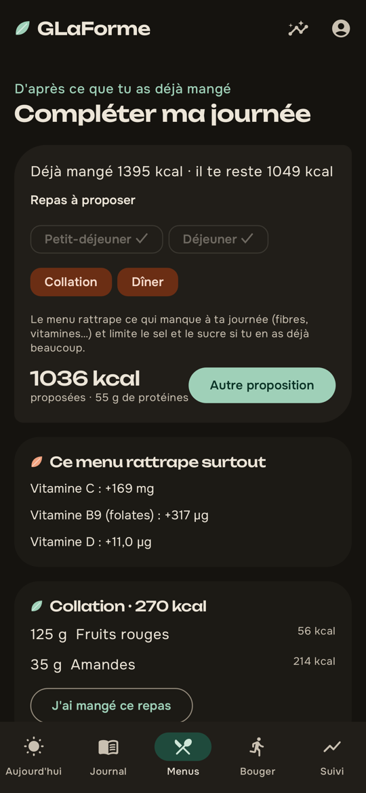
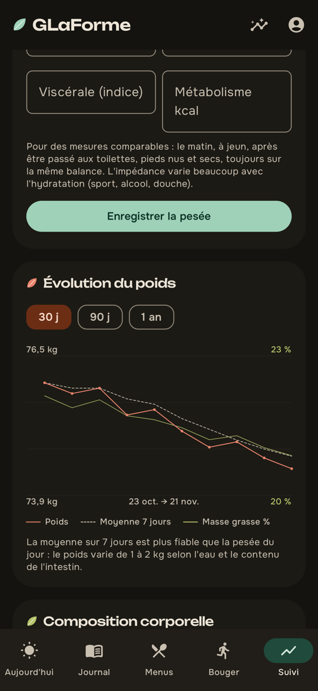

# GLaForme

**Ton carnet de forme, 100 % sur ton téléphone.**

GLaForme calcule ce dont ton corps a besoin chaque jour (énergie, protéines, fibres, vitamines, minéraux, eau), propose des menus qui couvrent ces besoins, et t'aide à suivre ce que tu manges vraiment, ton eau, ton poids et un peu d'activité sans matériel.

Pensée pour celles et ceux qui n'y connaissent rien en nutrition, sur la base des recommandations officielles françaises et européennes (ANSES, EFSA).

  
  
  
  

## Ce que fait l'app

- **Tes besoins du jour**, calculés selon ton profil, ton activité et tes pas (Health Connect).
- **Un journal de repas** avec plus de 2 000 aliments (table Ciqual de l'ANSES). La recherche tolère les fautes, les accents et l'ordre des mots.
- **Compléter ma journée** : tu as mangé dehors ce midi ? Note-le au plus proche, l'app propose le dîner qui rattrape ce qui manque.
- **Eau, poids, balance à impédance** (saisie manuelle ou via Health Connect), courbe et bilan sur 7 et 30 jours.
- **Bouger** : un programme de 4 semaines sans matériel et des pauses écran de 3 minutes, avec un minuteur guidé.
- **Rappels** utiles : boire (seulement si tu es en retard), noter tes repas.

## Tes données restent chez toi

- **Rien n'est envoyé, vendu ni partagé.** Pas de compte, pas de publicité, pas de statistiques.
- La seule connexion de l'app : une fois par jour, elle demande à GitHub le numéro de la dernière version, pour te prévenir des mises à jour. Cette requête ne contient aucune de tes données (et se désactive dans les réglages).
- Aucune sauvegarde dans le cloud : tu peux exporter une sauvegarde (fichier JSON) et la restaurer sur un autre téléphone.
- Tout s'efface d'un bouton (Profil et réglages › Mes données).

> GLaForme donne des repères nutritionnels généraux. Ce n'est pas un dispositif médical : elle ne remplace pas l'avis d'un médecin ou d'un(e) diététicien(ne), notamment en cas de maladie, de grossesse ou de trouble alimentaire. Réservée aux adultes.

## Installer

Android 9 ou plus récent.

1. Ouvre la page **[Releases](../../releases/latest)** depuis ton téléphone.
2. Télécharge le fichier `GLaForme-vX.Y.Z.apk`.
3. Ouvre-le. Android demande d'autoriser l'installation depuis ton navigateur : accepte, puis **Installer**.

L'application n'est pas sur le Play Store : c'est normal qu'Android affiche un avertissement la première fois.

## Mises à jour

GLaForme te prévient elle-même : quand une nouvelle version est publiée ici, tu reçois une notification qui ouvre cette page. Télécharge le nouvel APK et installe-le par-dessus l'ancien : **tes données sont conservées**.

Tu peux aussi vérifier à la main dans *Profil et réglages › À propos › Vérifier maintenant*.

## Donner ton avis

Dans l'app : **Profil et réglages › À propos › Envoyer un retour**. Ça prépare un message avec la version et le modèle du téléphone, que tu envoies par l'appli de ton choix. Si l'app plante, elle te proposera au lancement suivant d'envoyer le rapport technique (il ne contient aucune de tes données).

Tu peux aussi ouvrir une [issue](../../issues) ici.

## Sources

ANSES (2016, 2021), EFSA (2010, 2013, 2019), équations de Mifflin-St Jeor et Katch-McArdle, Compendium of Physical Activities, table Ciqual 2020 (ANSES, Licence Ouverte). Polices Unbounded et Onest (SIL OFL 1.1), icônes Material Symbols (Apache 2.0).

Le code source de GLaForme n'est pas publié ; ce dépôt sert à distribuer l'application.
